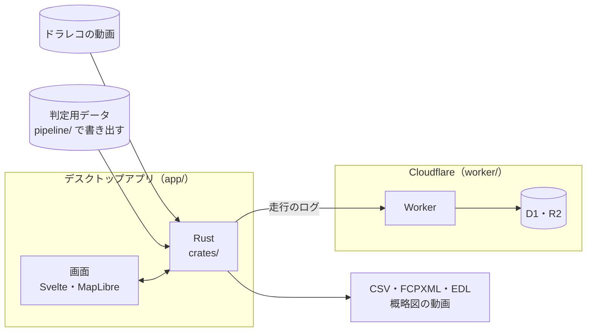

# ルートログ

バイクの走行経路と時刻を記録し、ドラレコ動画に入れる字幕の候補とタイミングを出すデスクトップアプリです 🏍️

GPS ログの無い動画でも、地図で経路を引き、動画を見ながら少数の時刻を確定すれば、県境・路線・橋・トンネル・道の駅を通った時刻が分かります。

## できること

- 動画フォルダを読み、ファイル名と長さから実時刻のタイムラインを作る
- 地図で経路を引く。国道・都道府県道に沿わせられる
- 経路から、境・路線・橋・トンネル・道の駅のイベントを抜き出し、通った時刻を推定する
- 動画を見ながらキーで時刻を確定する
- 書き出す
  - 通過時刻の CSV
  - DaVinci Resolve 向けの、停車を抜いたタイムライン（FCPXML）とマーカー（EDL）
  - 冒頭に入れる経路の概略図の動画
- 走行のログを Cloudflare に同期する。動画はどこにも送らない

## 構成



- 編集はローカルの Tauri アプリで行い、走行は手元の JSON に保存する
- 判定用データは、国道マップ（[nanase/kokudo-map](https://github.com/nanase/kokudo-map)）の生成物から書き出す
- 同期の先は Cloudflare Access の後ろに置いた Worker で、D1 と R2 に走行を持つ

詳しくは [全体の構成](docs/reference/architecture.md) にあります。

## 開発の始め方

Windows で動かしています。mise で道具の版を揃え、`app/` で依存を入れて起動します。

```sh
mise install
cd app
mise exec -- bun install --frozen-lockfile
mise exec -- bun run tauri dev
```

Rust の準備、テスト、動作確認、Worker の動かし方は [開発](docs/guides/development.md) にあります。

## 文書

仕組みと運用の文書は `docs/` にあります。

- 手順書
  - [開発](docs/guides/development.md): 手元で動かし、検査する
  - [判定用データ](docs/guides/geo-data.md): 国道マップの生成物から判定用データを書き出す
  - [設定とデプロイ](docs/guides/deployment.md): Cloudflare の準備、マイグレーション、Worker の入れ替え
- リファレンス
  - [目的と範囲](docs/reference/overview.md): 背景、MVP の範囲、マイルストーン
  - [全体の構成](docs/reference/architecture.md): ディレクトリ、技術スタック、ローカルの保存
  - [時間軸](docs/reference/timeline.md): 動画ファイルと実時刻、時計の補正
  - [データ](docs/reference/data.md): 走行・経由地・イベント、D1 のスキーマ
  - [地図・道路データ](docs/reference/geo.md): 判定用データの中身、橋・トンネルの公称の長さ、吸着
  - [イベント抽出と時刻推定](docs/reference/processing.md): 抽出の手順、国道の交差点、停車の扱い
  - [画面と操作](docs/reference/ui.md): 経路入力と時刻入力の画面、キー操作
  - [動画の再生](docs/reference/playback.md): H.265 の直接再生
  - [クラウド API と同期](docs/reference/cloud.md): API、認証、自動の同期
  - [出力](docs/reference/output.md): CSV、概略図の動画
  - [Resolve 連携](docs/reference/resolve.md): 停車の検出、FCPXML とマーカーの書き出し
  - [決定事項と未決事項](docs/reference/decisions.md)

## ライセンス

[MIT](LICENSE.md)

### データの出典

判定用データとタイルはリポジトリに含めず、手元で用意するか、実行時に取ります。使うときは、それぞれの出典を示してください。

| データ | 出典 | ライセンス |
| --- | --- | --- |
| 道路・橋・トンネル・道の駅 | © OpenStreetMap contributors | ODbL 1.0 |
| 行政区域 | 国土数値情報（行政区域データ）、国土交通省 | CC BY 4.0 |
| 背景地図・概略図の写真 | 地理院タイル、国土地理院 | 国土地理院コンテンツ利用規約 |
| 橋・トンネルの公称の名前と長さ | 全国Q地図のタイル。元データは国土交通省の全国道路施設点検データベース | 各提供元の規約 |
