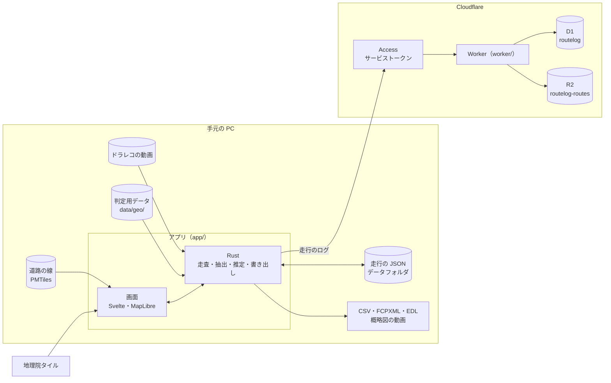

# 全体の構成

編集はローカルの Tauri アプリで行い、ログ（経路・時刻・イベント）だけを Cloudflare に保存します。動画はローカルで参照するだけで、どこにも送りません。



動画と地図データはローカルで読み込みます。Rust 側で処理した結果のうち、ログだけを Access 経由で Worker に送ります。

| 層 | 技術 | 役割 |
| --- | --- | --- |
| デスクトップアプリ | Tauri 2 + Rust | 動画フォルダ走査、ffprobe 呼び出し、地理判定、吸着、書き出し、API 通信 |
| フロントエンド | TypeScript + Svelte 5 + MapLibre GL JS + PMTiles | 地図表示、経路編集、動画再生、タイムライン UI |
| 地図データ | 国道マップの生成物から書き出した判定用データ、国土数値情報（行政区域）、地理院タイル | 背景地図、道路線形、行政界 |
| API | Cloudflare Workers（workers-rs） | 走行ログの CRUD |
| DB | Cloudflare D1 | 走行・経由地・アンカー・イベント |
| オブジェクト | Cloudflare R2 | 経路ジオメトリ（GeoJSON）、書き出し済み GPX |
| 認証 | Cloudflare Access（サービストークン） | 書き込み API の保護 |
| 共有（後回し） | Cloudflare Pages | 閲覧専用ページ |

## ディレクトリ

Cargo workspace のモノレポです。判定用データの書き出しもこのリポジトリに置き、国道マップの生成物を読み取りだけで使います。

```text
crates/
  routelog-core/      データ型、時刻変換、時刻推定。入出力を持たない
  routelog-access/    Cloudflare Access のトークンの検証
  routelog-geo/       判定用データの読み込み、イベント抽出、吸着グラフ
  routelog-overview/  概略図の動画。写真のタイル、経路の描画、ffmpeg への受け渡し
  routelog-video/     ファイル名の解析、ffprobe と ffmpeg の呼び出し、停車の検出
app/
  src-tauri/          Tauri のコマンド、ローカルの保存、API のクライアント
  src/                フロントエンド（TypeScript + Svelte 5 + MapLibre）
worker/               Cloudflare Worker（workers-rs）と D1 のマイグレーション
pipeline/             判定用データの書き出し（Python、uv）
data/                 書き出した判定用データ。git では追跡しない
docs/                 文書
mise.toml             node・bun・ffmpeg・python・uv の版と、書き出しのタスク
```

## 共通 crate

データ型（Ride、Event など）は `routelog-core` crate にまとめ、Tauri 側と Worker 側の両方で使います。serde でシリアライズし、API の型ずれを防ぎます。

`routelog-core` は wasm で通る依存に絞ります。Tokio のようなスレッド型のランタイムは、Worker で使えないためです。

## オフライン前提

編集はローカルに保存し、保存のあとに自動で Cloudflare に送ります。通信できないときも編集と保存は続けられ、繋がってから送ります。同期の決まりは [クラウド API と同期](cloud.md) にあります。

## ローカルの保存

データフォルダは、OS が決めるアプリのデータの置き場所の下に、アプリの識別子 `cc.nanase.routelog` の名前で作られます。

- 走行 1 つを JSON ファイル 1 つに書く。置き場所はデータフォルダの `rides/<走行の ID>.json`
- API が走行を丸ごと送り受けするので、手元でも同じ形のまま持つ。SQLite は使わない
- 編集のたびに 0.4 秒待ってから保存する。別名で書いてから置き換え、書きかけのファイルを残さない
- 開いたフォルダの場所は `config.json` に覚える。フォルダの場所は環境ごとに違うので、リポジトリには置かない
- 走行の動画フォルダは、日付ごとに `video-folders.json` に覚える。最後に読んだ動画（名前・時刻・長さ）も一緒に持ち、走行の一覧の本数と長さに使う。外した動画と同じく、走行のデータには入れず、クラウドにも送らない
- 走行から外した動画は、日付ごとのファイル名を `excluded-videos.json` に覚える。動画は手元にしか無いので、走行のデータには入れず、クラウドにも送らない
- 停車の候補は、動画 1 本ごとに `stops/<動画のファイル名>.json` に覚える。外した動画と同じく、手元だけに持つ
  - 持つのは、1 秒ごとに測った値（音の大きさ、キーフレームの差、0.1 秒ごとの差）と、動画の長さ、外した候補の区間である。1 時間の動画で約 60 KB
  - 候補は、読むたびにいまの規則で測った値から出す。規則を変えても、動画を読み直さずに済む
  - 測り方の版も持つ。測り方（どこを細かく測るか）を変えたら版を上げ、前の測定は使わずに測り直す。長さが違えば、同じ名前の別の動画とみなして使わない
  - 外した候補は区間で覚える。規則を変えて候補の端がずれても、重なる候補を外したままにする
- 同期の覚えは `sync.json` に持つ（[アプリからの同期](cloud.md#アプリからの同期)）
- 環境変数 `ROUTELOG_DATA_DIR` で、データフォルダを別の場所にできる
- 開発中とリリースビルドは、同じデータフォルダを使う。走行も `config.json` も共通である
  - 地図の表示位置や音量など画面側の覚え（localStorage）は、開発中（`localhost:1420`）とリリースビルド（`tauri.localhost`）で別になる

## リリースビルド

作り方は [開発](../guides/development.md#リリースビルド) にあります。

- インストーラーは作らず、`target/release/routelog.exe` だけができる
- 画面は exe に入る。判定用データ・道路データ・ffmpeg は入れず、開発中と同じ場所から読む
  - exe だけを別の場所に写し、mise も PATH も無しで起動しても動く。データの場所と ffmpeg の場所は `config.json` から読む
  - ffmpeg の場所は、リポジトリの中で 1 度起動したときに覚える（開発中の起動か、`target/release` に置いたままの exe）。覚える前にリポジトリの外で起動すると、ffprobe と ffmpeg が見つからない
  - 2026-10-24 に、写した exe を PATH を空にして起動し、地図の確認（概略図の動画の書き出しを含む）とフォルダの確認が通った
- `[profile.release]` は Worker に合わせて大きさを優先する。開発中に最適化している crate は、リリースでも速さを優先する

## 道具

node・bun・ffmpeg・python・uv の版は `mise.toml` で固定し、パッケージ管理は bun に揃えます。Rust は rustup で入れ、Worker 用に `wasm32-unknown-unknown` を足します。

dev プロファイルでは、デバッグ情報を行番号だけに削り、`target/` の肥大を抑えます。抽出と概略図の動画に関わる crate は、開発中でも最適化します。理由はルートの `Cargo.toml` のコメントにあります。
